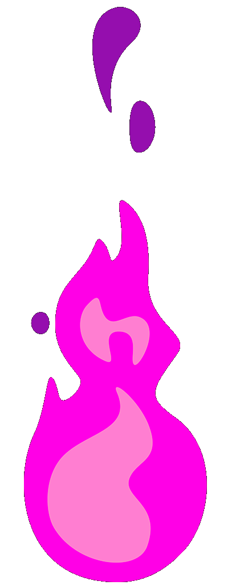
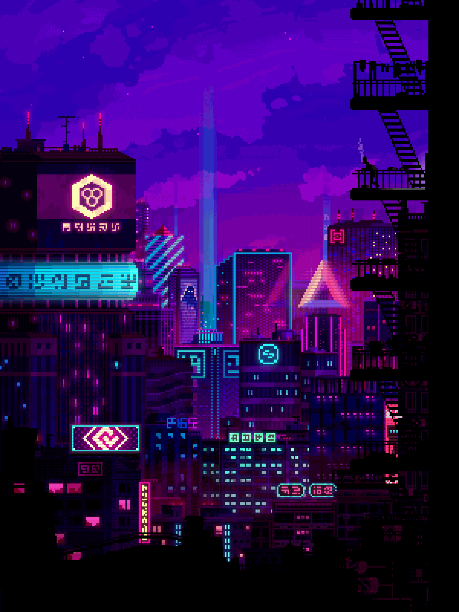

 

  
  
  

<h2></h2>

<h2 align="center"> Turning ideas into production-ready software 🚀</h2> 

- 👋 Hey there! I'm **Bilal Ahmed** — a CS graduate from the University of Karachi who genuinely enjoys turning ideas into working software.  

- 💻 Currently working as a **Full Stack Developer** — I make websites, mobile apps, backend APIs, and handle server deployments.  

- 🎯 **2025 Goals:** Diving deeper into System Design and cloud architecture. Always leveling up.  

- 🎮 When I'm not coding, you'll find me in competitive gaming or exploring new tech rabbit holes.  

- ☕ Fun fact: I debug better with coffee. That's just science.  

<h2></h2>

 

<h2></h2>

   

  
  
  
  <h2> ⚙️ Tech Stack & Tools </h2>
   
  
  
   

   
  
  <h2></h2>
  
  <!-- Programming Languages -->
  <h3>🧠 Programming Languages</h3>
  
<em>The core languages I use daily to build software</em>

  

    
    
    
    
  

  
  <h2></h2>
  
  <!-- Front-End -->
  <h3>🎨 Front-End</h3>
  
<em>Building beautiful, responsive user interfaces</em>

  

    
    
    
    
    
    
  

  

    
    
    
    
  

  

    
    
    
    
    
  

  
  <h2></h2>
  
  <!-- Back-End -->
  <h3>⚡ Back-End</h3>
  
<em>Server-side development, APIs & database wizardry</em>

  

    
    
    
    
  

  

    
    
    
    
    
  

  

    
    
    
    
    
  

  
  <h2></h2>
  
  <!-- DevOps & Cloud -->
  <h3>☁️ DevOps & Cloud</h3>
  
<em>Infrastructure, deployment & keeping things running smoothly</em>

  

    
    
    
    
    
  

  

    
    
    
    
    
  

  

    
    
    
    
  

  
  <h2></h2>
  
  <!-- AI & ML -->
  <h3>🤖 AI & Machine Learning</h3>
  
<em>Building intelligent systems & data pipelines</em>

  

    
    
    
    
  

  

    
    
    
    
  

  
  <h2></h2>
  
  <!-- Tools -->
  <h3>🛠️ Tools & Workflow</h3>
  
<em>What I use to stay productive</em>

  

    
    
    
    
    
  

  

    
    
    
  

  
   

<h2></h2>

<h2 align="center"> 🤝 Let's Connect! </h2>

  
  

   

 

 

  

 

<h2></h2>

  <h2> 🏆 GitHub Stats </h2> 
    <h2></h2> 
  
  

  

  
    
  <em>Thanks for stopping by! Feel free to reach out if you want to collaborate on something cool. ✌️</em>

